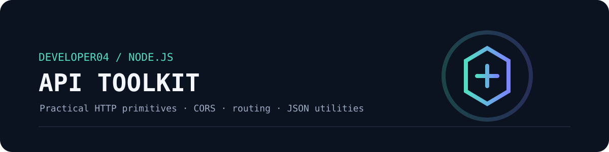

<p align="center"></p>

# d04-api-toolkit

A compact set of practical HTTP primitives for Node.js services: JSON responses, bounded request-body parsing, CORS handling, and lightweight routing.

## Features
- JSON response helper with custom headers
- Streaming JSON body reader with a size limit
- CORS wrapper with preflight handling
- Minimal method/path router
- Node.js 20+ ES modules; no runtime dependencies

## Usage
```js
import { createApiServer, createRouter, json, readJson } from "d04-api-toolkit";

const router = createRouter();
router.get("/health", (_req, res) => json(res, 200, { status: "ok" }));
router.post("/echo", async (req, res) => json(res, 200, await readJson(req)));
createApiServer(router, { cors: { origin: "https://app.example.com" } }).listen(8787);
```

## Exports
| Export | Purpose |
| --- | --- |
| `json(res, status, data, headers)` | Send a JSON response |
| `readJson(req, options)` | Read and parse bounded JSON |
| `withCors(handler, options)` | Add CORS and OPTIONS handling |
| `createRouter()` | Register and dispatch routes |
| `createApiServer(router, options)` | Create a Node HTTP server |

## Development
```bash
npm test
```

## License
MIT
